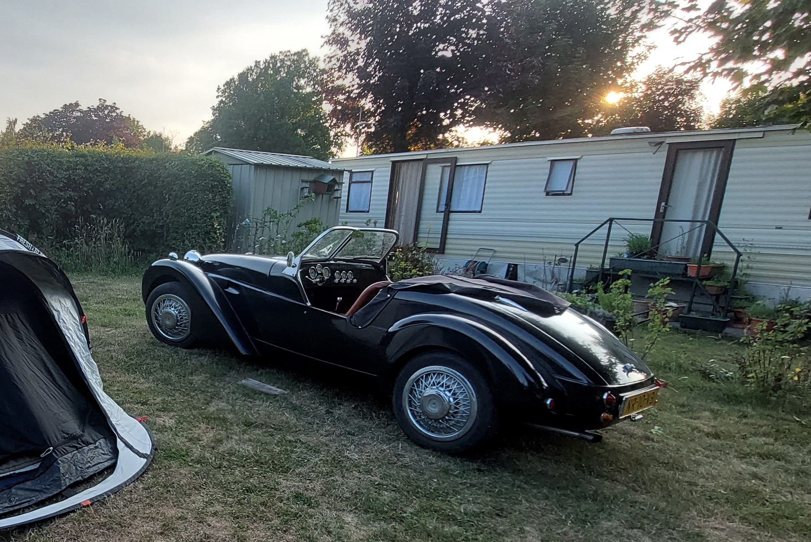

Hi, my name is *Ruben*.

I am currently in my second year of the following Master: [Methodology, Statistics and Data Science](https://www.uu.nl/en/masters/methodology-statistics-and-data-science){target="_blank"} at Utrecht University. My thesis, which is ongoing, is about finding possible improvements in the `mice` package in high-dimensional setting by focusing on the variable selection step.

Before that I did a bachelor in Psychology, also at Utrecht University.
My Bachelor thesis was at the department of Methodology, Statistics and Data Science at the same university and investigated the quality and reproducibility of research using supervised machine-learning. 

When I am not too busy studying and working on my thesis, I am most likely doing one of the following: reading (mainly history), gaming.hanging out with friends, cooking, hiking or when the weather allows driving a self-made car.

